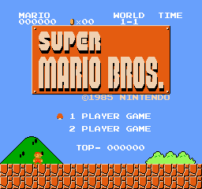
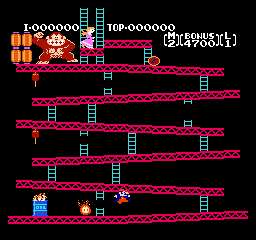
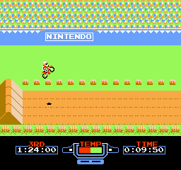
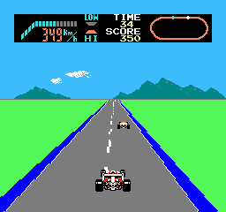
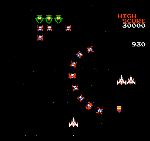
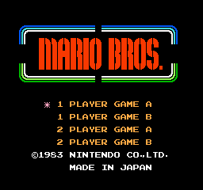
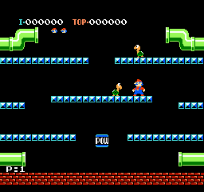

# RobotNES

Yet another Nintendo Entertainment System emulator written in C#.

- System bus
- Cartridge loading (ines 1.0 format)
- System memory with mirroring
- 6502 CPU emulation
- All official instructions are implemented
- Unofficial opcodes from `nestest.nes` are implemented
- Controller implementation (Controller 1: A, S, Up, Down, Left, Right, Space, Enter)
- PPU implementation
- PPU clocked by bus accesses
- Fake APU implementation (disregards any reads or writes)

Only works with NROM (mapper 0) games

Tested with: Donkey Kong, Donkey Kong Jr., Donkey Kong3, Excitebike, Galaga, Galaxian, Bomberman, Magic Jewelry, Mario Bros., Super Mario Bros. 1, F1 Race, Pinball, 1942, Baseball, Battle City, Kungfu, Karateka, Macross, Ice Climber, Road Fighter, Soccer

# Screenshots

Files in `NesCoreTests/TestROMs/` are dumps of real games, but all of their data content are randomized to avoid any copyright issues, only the header data kept intact. (Except nestest.nes which is a freely available test ROM)