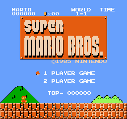
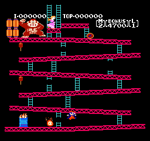
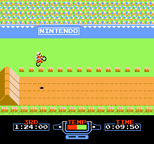
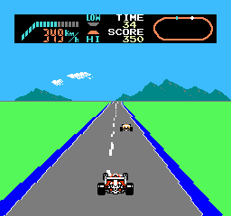
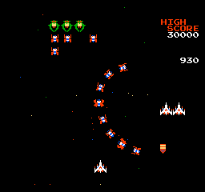
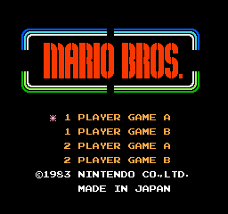
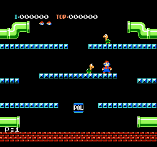

# RobotNES

Yet another Nintendo Entertainment System emulator written in C#.

Project skeleton only with partially implemented bus and memory systems.

## Partially implemented

- System bus
- Cartridge loading (ines 1.0 format)
- System memory with mirroring
- CPU emulation architecture
- All official instructions are implemented
- Unofficial opcodes from `nestest.nes` are implemented
- Controller implementation (Controller 1: A, S, Up, Down, Left, Right, Space, Enter)
- PPU implementation
- Fake APU implementation (disregards any reads or writes)

Only works with NROM (mapper 0) games

# Screenshots

Files in `NesCoreTests/TestROMs/` are dumps of real games, but all of their data content are randomized to avoid any copyright issues, only the header data kept intact. (With the exception of nestest.nes which is a freely available test ROM)