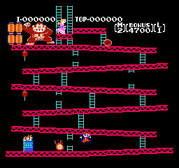
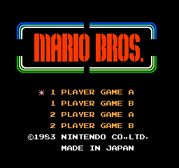
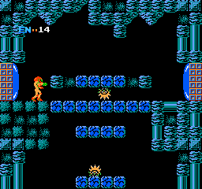
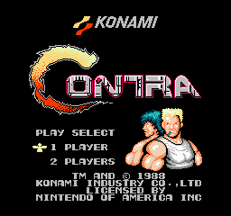
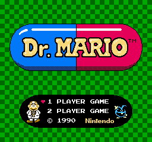

# RobotNES

Yet another Nintendo Entertainment System emulator written in C#.

- System bus
- Cartridge loading (ines 1.0 format)
- System memory with mirroring
- 6502 CPU emulation
- All official instructions are implemented
- Unofficial opcodes from `nestest.nes` are implemented
- Controller implementation (Controller 1: A, S, Up, Down, Left, Right, Space, Enter)
- PPU implementation
- PPU clocked by bus accesses
- Pulse channel 1 & 2, triangle channel, noise, DMC, frame counter irq, and length counter is implemented in the APU
- Tests from pages 1-9 in AccuracyCoin.nes fully pass 
- Basic Xbox controller support

Works with NROM (mapper 0), MMC1 (mapper 1), UxROM (mapper 2) and CNROM (mapper 3) , AOROM (mapper 7) games

Tested with: Donkey Kong, Donkey Kong Jr., Donkey Kong3, Excitebike, Galaga, Galaxian, Bomberman, Magic Jewelry, Mario Bros., Super Mario Bros. 1, F1 Race, Pinball, 1942, Baseball, Battle City, Kungfu, Karateka, Macross, Ice Climber, Road Fighter, Soccer, Megaman, Contra, Ducktales, Arkanoid, Track & Field, Gradius, Double Dragon, Robocop 3, Metroid, Chip 'n Dale Rescue Rangers 2

# Screenshots

Files in `NesCoreTests/TestROMs/` are dumps of real games, but all of their data content are randomized to avoid any copyright issues, only the header data kept intact. (Except nestest.nes which is a freely available test ROM)